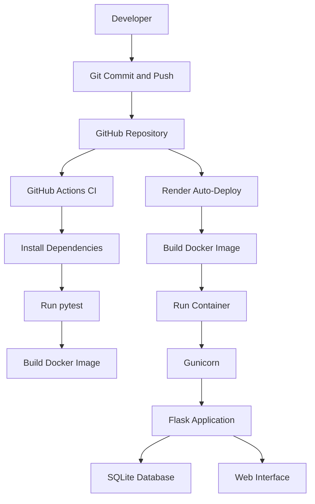

# Personal Expense Tracker with Automated Deployment

## 1. Project Overview

The Personal Expense Tracker is a Flask-based web application designed to help users record, manage, and analyze their personal expenses through a web interface.

This project extends an existing Expense Tracker application by incorporating DevOps practices, including version control, Docker containerization, automated testing, Continuous Integration (CI), and cloud deployment.

The application is hosted on Render, while GitHub Actions automates the testing and Docker image build process whenever changes are pushed to the repository.

## 2. Objectives

The primary objectives of this project are:

- To run a web-based application for personal expense management.
- To maintain source code using Git and GitHub.
- To containerize the application using Docker.
- To automate application testing using pytest.
- To implement a Continuous Integration pipeline using GitHub Actions.
- To deploy the application to a cloud hosting platform.
- To enable automatic deployment when changes are pushed to the main branch.
- To understand the workflow from local development to cloud deployment.

## 3. Features

### Application Features

- Record and manage personal expenses.
- View expense records through a web interface.
- Organize expenses using the application's supported categories.
- Store expense records using SQLite.
- Access expense-management functionality through Flask routes and HTML templates.

### DevOps Features

- Version control using Git.
- Source code management using GitHub.
- Containerization using Docker.
- Automated homepage testing using pytest.
- Automated testing and Docker image building using GitHub Actions.
- Cloud deployment using Render.
- Automatic deployment following changes to the connected GitHub repository.

## 4. Technology Stack

| Technology | Purpose |
|---|---|
| Python | Backend programming language |
| Flask | Web application framework |
| Flask-SQLAlchemy | Database integration |
| SQLite | Database for expense records |
| HTML and Jinja2 | Web interface and template rendering |
| Git | Version control |
| GitHub | Source code hosting |
| Docker | Application containerization |
| Gunicorn | WSGI server for running the Flask application |
| pytest | Automated testing |
| GitHub Actions | Continuous Integration |
| Render | Cloud hosting and automatic deployment |

## 5. Project Structure

```text
Personal-Expense-Tracker-DevOps/
│
├── .github/
│   └── workflows/
│       └── ci.yml
│
├── .pytest_cache/
├── .venv/
├── __pycache__/
│
├── instance/
│   └── expenses.db
│
├── templates/
│   ├── base.html
│   └── index.html
│
├── .dockerignore
├── .gitignore
├── app.py
├── Dockerfile
├── README.md
├── requirements.txt
└── test_app.py
```

**File and directory descriptions**

- `app.py` — Contains the Flask application, routes, and database-related operations.
- `templates/` — Contains the HTML templates used to render the application interface.
- `base.html` — Defines the common page layout.
- `index.html` — Defines the main application page.
- `instance/expenses.db` — Local SQLite database file.
- `requirements.txt` — Lists the Python packages required by the application.
- `Dockerfile` — Defines the instructions for building the Docker image.
- `.dockerignore` — Excludes unnecessary files from the Docker build context.
- `.gitignore` — Excludes local environments, generated files, and database files from version control.
- `test_app.py` — Contains the automated homepage smoke test.
- `.github/workflows/ci.yml` — Defines the GitHub Actions CI workflow.
- `.venv/` — Local Python virtual environment.
- `__pycache__/` and `.pytest_cache/` — Generated Python and pytest cache directories.

The virtual environment and cache directories are local development artifacts and should not be committed to the repository.

## 6. System Architecture



The architecture consists of two main workflows.

**Continuous Integration:** GitHub Actions checks out the repository, installs dependencies, runs automated tests, and builds the Docker image.

**Cloud Deployment:** Render detects changes in the connected repository, builds the application using the Dockerfile, and deploys the resulting container.

GitHub Actions and Render operate independently: GitHub Actions performs CI, while Render handles cloud deployment.

## 7. Implementation

### 7.1 Version Control Using Git and GitHub

The project is maintained in a dedicated GitHub repository:

https://github.com/GreeshmaReddy427/Personal-Expense-Tracker-DevOps

Git is used to track changes, create commits, and maintain the project history. GitHub provides centralized source code storage and integration with the CI and deployment services.

### 7.2 Docker Containerization

A Dockerfile was created using the `python:3.11-slim` base image.

The Docker build process:

1. Sets the working directory to `/app`.
2. Copies `requirements.txt` and installs the application dependencies.
3. Installs Gunicorn.
4. Copies `app.py` and the `templates/` directory into the image.
5. Creates the application instance directory.
6. Starts the Flask application through Gunicorn.

The container listens on the port provided by the hosting environment, with port `5000` used as the default for local execution.

Docker allows the application and its runtime dependencies to be packaged into a consistent execution environment.

### 7.3 Automated Testing Using pytest

The project includes a smoke test in `test_app.py`.

The test sends a request to the application's homepage and verifies that the response status code is `200 OK`.

Run the test locally using:

```bash
python -m pytest -v
```

This test checks basic homepage availability. It does not provide complete coverage of all expense-management operations.

### 7.4 Continuous Integration Using GitHub Actions

The workflow configuration is stored at:

```text
.github/workflows/ci.yml
```

The workflow runs on:

- Pushes to the `main` branch.
- Pull requests targeting the `main` branch.

The CI pipeline performs the following steps:

1. Checks out the repository.
2. Sets up Python 3.11.
3. Installs the application dependencies, pytest, and Gunicorn.
4. Runs the automated tests.
5. Builds the Docker image.

Successful workflow runs confirm that the configured test and image-build steps completed successfully.

### 7.5 Cloud Deployment Using Render

The application is deployed on Render as a Docker-based web service.

Deployment configuration:

| Setting | Value |
|---|---|
| Source repository | `GreeshmaReddy427/Personal-Expense-Tracker-DevOps` |
| Branch | `main` |
| Runtime | Docker |
| Region | Singapore |
| Instance plan | Free |

Render builds the application from the Dockerfile and runs the container using Gunicorn.

Automatic deployment is enabled for the connected repository. When a new commit is pushed to `main`, Render detects the change and starts a new deployment.

The successful deployment of the `Test automatic Render deployment` commit confirmed that Render detected a GitHub push and brought the new deployment live.

**Live Application:** [Personal Expense Tracker](https://personal-expense-tracker-devops.onrender.com/)

## 8. Local Setup and Execution

### Prerequisites

- Python 3.11 or a compatible Python version.
- Git.
- Docker Desktop, if using Docker.

### Step 1: Clone the Repository

```bash
git clone https://github.com/GreeshmaReddy427/Personal-Expense-Tracker-DevOps.git
cd Personal-Expense-Tracker-DevOps
```

### Step 2: Create a Virtual Environment

For Windows PowerShell:

```powershell
python -m venv .venv
.\.venv\Scripts\Activate.ps1
```

### Step 3: Install Dependencies

```bash
python -m pip install -r requirements.txt
```

### Step 4: Run the Application Locally

```bash
python app.py
```

Open the following address in your browser:

```text
http://127.0.0.1:5000
```

### Step 5: Run Automated Tests

Install pytest if it is not already available:

```bash
python -m pip install pytest
```

Execute the tests:

```bash
python -m pytest -v
```

### Step 6: Build the Docker Image

```bash
docker build -t expense-tracker .
```

### Step 7: Run the Docker Container

```bash
docker run -d --name expense-tracker-app -p 5000:5000 -v expense_data:/app/instance expense-tracker
```

Access the application at:

```text
http://localhost:5000
```

To stop the container:

```bash
docker stop expense-tracker-app
```

To start the existing container again:

```bash
docker start expense-tracker-app
```

The named Docker volume stores local container data separately from the container's writable filesystem. It is not shared with Render.

## 9. Deployment Verification

The following checks were completed during implementation:

- The application ran successfully in a local Docker container.
- The homepage smoke test passed through GitHub Actions.
- The CI workflow successfully built the Docker image.
- The application was deployed successfully on Render.
- A subsequent GitHub push triggered Render Auto-Deploy.
- The deployment reached the live state, and the hosted application was accessible.

These checks demonstrate the implemented workflow from source control through automated verification and cloud deployment.

## 10. Limitations

- The automated test suite currently contains a basic homepage smoke test.
- Render's free web services use an ephemeral filesystem.
- SQLite data stored on Render is not guaranteed to persist across restarts, redeployments, or service spin-downs.
- Free web services may spin down after periods of inactivity, delaying the first subsequent request.
- The GitHub Actions workflow builds the Docker image but does not publish it to a container registry.
- The CI workflow does not directly deploy the application to Render.
- The project is intended for educational purposes and is not configured as a production-grade financial service.

For reliable cloud data persistence, the application would need to be configured with an appropriate persistent database and database connection settings.

## 11. Future Enhancements

- Extend automated tests to cover expense creation, deletion, and filtering.
- Configure a persistent managed database for cloud deployment.
- Improve environment-based configuration and secret management.
- Integrate container image vulnerability scanning.
- Publish Docker images to a container registry.
- Add health checks and application monitoring.
- Expand CI/CD automation and deployment verification.

## 12. Conclusion

The Personal Expense Tracker with Automated Deployment demonstrates the practical application of DevOps principles to a Flask web application.

The project integrates Git and GitHub for version control, Docker for containerization, pytest for automated testing, GitHub Actions for Continuous Integration, and Render for cloud deployment.

The implementation provides a foundation for understanding how application code can be tested, packaged, and deployed through a repeatable workflow.

## 13. Acknowledgements

The original Expense Tracker application was referenced from:

https://github.com/LokeshGopal2104/expense-tracker

DevOps configuration, automated testing, CI workflow, and cloud deployment were added as part of this project.
